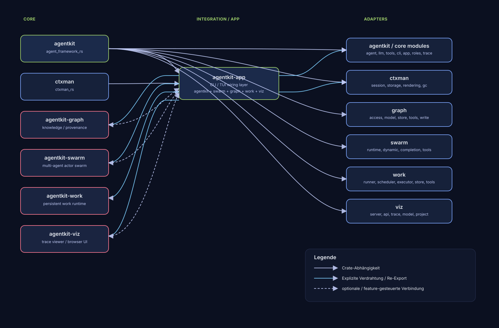

# Architecture Graph

## Nodes
- `agentkit` = `agent_framework_rs`
- `agentkit-app` = `agentkit_app`
- `agentkit-graph` = `agentkit_graph`
- `agentkit-swarm` = `agentkit_swarm`
- `agentkit-viz` = `agentkit_viz`
- `agentkit-work` = `agentkit_work`
- `ctxman` = `ctxman_rs`

## Crate Dependencies / Feature Gates
- `agentkit-app -> agentkit [label=dep]` (`agentkit_app/Cargo.toml:16`)
- `agentkit-app -> agentkit-swarm [label=dep]` (`agentkit_app/Cargo.toml:17`)
- `agentkit-app -> agentkit-graph [label=optional dep via feature graph]` (`agentkit_app/Cargo.toml:19,49`)
- `agentkit-app -> agentkit-work [label=optional dep via feature work]` (`agentkit_app/Cargo.toml:21,53`)
- `agentkit-app -> agentkit-viz [label=optional dep via feature viz]` (`agentkit_app/Cargo.toml:24,56`)

- `agentkit-graph -> agentkit [label=dep]` (`agentkit_graph/Cargo.toml:14`)
- `agentkit-swarm -> agentkit [label=dep]` (`agentkit_swarm/Cargo.toml:14`)
- `agentkit-work -> agentkit [label=dep]` (`agentkit_work/Cargo.toml:14`)
- `agentkit-viz -> agentkit-work [label=optional dep via feature work]` (`agentkit_viz/Cargo.toml:24,40`)
- `agentkit-viz -> agentkit-graph [label=optional dep via feature graph]` (`agentkit_viz/Cargo.toml:27,42`)
- `agentkit -> ctxman [label=optional dep via feature ctxman]` (`agent_framework_rs/Cargo.toml:29`)
- `agentkit -> ratatui [label=optional dep via feature tui]` (`agent_framework_rs/Cargo.toml:24`)
- `agentkit -> pdf-extract [label=optional dep via feature pdf]` (`agent_framework_rs/Cargo.toml:27`)
- `agentkit -> ureq [label=optional dep via feature openai]` (`agent_framework_rs/Cargo.toml:20`)
- `ctxman -> ureq [label=optional dep via feature http]` (`ctxman_rs/Cargo.toml:17`)
- `agentkit-app -> ureq [label=optional dep via feature upgrade]` (`agentkit_app/Cargo.toml:35,63`)
- `agentkit-graph -> ctxman [label=feature ctxman -> agentkit/ctxman]` (`agentkit_graph/Cargo.toml:22-23`)
- `agentkit-swarm -> ctxman [label=feature ctxman -> agentkit/ctxman]` (`agentkit_swarm/Cargo.toml:22-23`)
- `agentkit-work -> ctxman [label=feature ctxman -> agentkit/ctxman]` (`agentkit_work/Cargo.toml:34-35`)
- `agentkit-app -> agentkit-viz [label=feature wiring in app/Cargo.toml]` (`agentkit_app/Cargo.toml:54-56`)

## Explicit Wiring / Re-Exports
- `agentkit-app -> agentkit-swarm [label=add_swarm_tool + SWARM_SYSTEM + SwarmToolConfig]` (`agentkit_app/src/lib.rs:11-12,41-50,152-167`)
- `agentkit-app -> agentkit-graph [label=GraphAccess/GraphStore re-export + register_graph_tools wiring]` (`agentkit_app/src/lib.rs:21-23,78-99,134-147`)
- `agentkit-app -> agentkit-graph [label=system prompt append GRAPH_SYSTEM]` (`agentkit_app/src/lib.rs:169-170,201-212`)
- `agentkit-app -> agentkit-work [label=WorkGraphAdapter/SwarmWorkExecutor re-export + wiring]` (`agentkit_app/src/lib.rs:24-32`)
- `agentkit-app -> agentkit-viz [label=frontend feature integration]` (`agentkit_app/Cargo.toml:54-56`)

- `agentkit -> ctxman [label=feature-gated context + attach_managed_context]` (`agent_framework_rs/src/lib.rs:41-43,150-154`)
- `agentkit -> ratatui [label=feature tui module]` (`agent_framework_rs/src/lib.rs:62-64`)
- `agentkit -> pdf-extract [label=extract_pdf_text feature]` (`agent_framework_rs/src/lib.rs:93-98`)
- `agentkit -> ureq [label=openai/anthropic/azure LLM path]` (`agent_framework_rs/src/lib.rs:144-148`)

## Internal Submodules
### agentkit (`agent_framework_rs/src/lib.rs:35-64`)
- `agent.rs`
- `app.rs`
- `cli.rs`
- `llm.rs`
- `tools.rs`
- `context.rs` *(cfg(feature="ctxman"))*
- `tui.rs` *(cfg(feature="tui"))*
- `subagents.rs`
- `roles.rs`
- `trace.rs`

### agentkit-app (`agentkit_app/src/lib.rs:14-32`)
- `upgrade.rs`
- `patch.rs`
- `work_graph.rs` *(cfg(feature="work","graph"))*
- `work_swarm.rs` *(cfg(feature="work"))*

### agentkit-graph (`agentkit_graph/src/lib.rs:53-62`)
- `access.rs`
- `agent.rs`
- `model.rs`
- `store.rs`
- `tools.rs`
- `write.rs`
- `retrieval.rs`
- `export.rs`

### agentkit-swarm (`agentkit_swarm/src/lib.rs:46-58`)
- `actor_ref.rs`
- `agent_actor.rs`
- `completion.rs`
- `directory.rs`
- `dynamic.rs`
- `events.rs`
- `mailbox.rs`
- `message.rs`
- `runtime.rs`
- `supervisor.rs`
- `tools.rs`
- `topology.rs`

### agentkit-work (`agentkit_work/src/lib.rs:29-41`)
- `cli.rs`
- `error.rs`
- `event.rs`
- `executor.rs`
- `graph.rs`
- `model.rs`
- `recovery.rs`
- `runner.rs`
- `scheduler.rs`
- `state.rs`
- `store.rs`
- `tools.rs`

### agentkit-viz (`agentkit_viz/src/lib.rs:32-38`)
- `api.rs`
- `bench.rs`
- `model.rs`
- `project.rs`
- `server.rs`
- `swarm.rs`
- `trace.rs`

### ctxman (`ctxman_rs/src/lib.rs:11-23`)
- `compaction.rs`
- `domain/mod.rs`
- `gc/mod.rs`
- `http.rs` *(cfg(feature="http"))*
- `promotion.rs`
- `rendering/mod.rs`
- `session/mod.rs`
- `snapshot.rs`
- `storage/mod.rs`
- `tokenization.rs`
